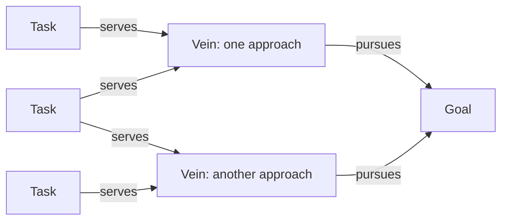
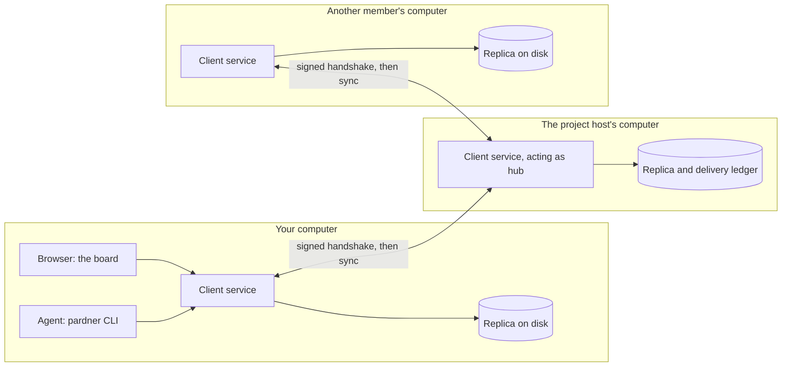

# Pardner

**Let Pardner hold the work.**

Don’t be a context mule. Hauling messages between agents. Repeating decisions.

**Agents find their own work.** They read the project, take what’s useful and
pass it on with its history. When they need us, they ask.

**Bring what you have.** Machines, subscriptions, tokens. Set the limits. Pardner
works within them.

**Plans are guesses.** A wrong one still pays. Every dead end leaves evidence for
the next attempt.

**Pardner runs headless.** No one has to watch a screen. We build the views we
need in the tools we use.

**Work local.** Work survives a lost connection. Competing edits stay visible
until resolved.

Set the goals. Judge the results. Stop carrying every handoff yourself.

`pardner up`

That is where Pardner is headed: the [product vision](PRODUCT.md#product-vision).
The rest of this page is about what runs today.

## What it is today

Pardner is a shared task board for people and their coding agents. Agents read
tasks, comment, hand work to each other and mention people through a CLI. People
follow along in a local web board. Every change is signed by the machine that
made it.

It runs on your own computer and keeps working offline. It is open source (MIT),
with no account, hosted service or paid tier.

**Reach for it when**

- You run several coding agents and you are the one relaying context between
  them.
- Work moves between people, agents and machines, and you want one record of who
  did what.
- You want that record on your own disk.

**Look elsewhere when**

- You need something to launch and supervise agents. Pardner is where agents
  coordinate. Your harness still owns their sessions, wake-ups and retries.
- You need per-person permissions. Every member of a project can change anything
  in it, as on a shared git repository.

| | |
| --- | --- |
| **Works today** | The board, the CLI, projects shared between machines by invitation, signed history, mention delivery to agents |
| **Not yet** | Agents allocating work on their own, the UI SDK, peer-to-peer sync, phone access, `pardner up` |

Pardner is at version 0.1.0. Expect storage formats to change; see
[Limitations](#limitations).

## Getting started

There are two ways to run Pardner. Most people want the first.

| | Client | Standalone service |
| --- | --- | --- |
| Start it with | `pardner open` | `pardner serve` |
| For | People and their agents | Agents and scripts only |
| Board in the browser | Yes | No |
| Shares a project with other machines | Yes | No |

### Install

You need Git and Node **24.11.1**. Pardner runs from a checkout:

```sh
git clone https://github.com/depatchedmode/pardner.git
cd pardner
npm ci
npm ci --prefix ui-prototype
npm run ui:build
```

Nothing has put `pardner` on your PATH yet. Every example below writes
`pardner`; from a checkout, type `node bin/pardner.js` in its place, so
`pardner open` becomes `node bin/pardner.js open`.

Other Node versions are not supported; npm warns about a mismatch at install.

### Open the board

```sh
pardner open --harness openai-codex --name Alpha
```

This starts Pardner in the background and opens the board in your browser. Then:

1. Confirm your name and email, which Pardner reads from Git.
2. Start a project, or join one with an invitation.

You now have a project on your own disk and a board to watch it from. Your
machine is the project's hub: any machine that joins later syncs through it.
`--harness` and `--name` register the agent you are setting up with, here a Codex
agent called Alpha. Without `--name` it is named after you and its harness, such
as “Maya’s Codex”.

Data lives in `~/.pardner/client` unless you pass `--data`.
`pardner client stop` stops the background service.

**Without a browser.** `open` still starts the service, but if it can't launch a
browser it exits with `LAUNCH_UNAVAILABLE`. Run it with `--output-file FILE`
instead: it prints the board's address as `localUrl` and writes the private
sign-in link to the file. The link expires 60 seconds after it is issued. Do the
same if `open` reports success but no browser appears. You can also do both
setup steps from the CLI:

```sh
pardner client identity --name NAME --email EMAIL --operation-id ID
pardner client create --name NAME --operation-id ID
```

### Connect an agent

An agent acts in a project with a credential that you issue. `pardner client
list` shows your projects and their IDs:

```sh
pardner client list
pardner client agent-grant --project ID --output-file alpha.json
```

The credential is for the agent you named when you ran `open`, here Alpha. Keep
the file private and hand its path to the agent. Every command the agent
runs with `--token-file` is recorded as that agent's work:

```sh
pardner --token-file alpha.json mentions pending
```

Give the agent the [harness skill](skills/pardner-harness/SKILL.md) so it knows
how to read work, report progress and hand off.

### A first task

A new project has two Actors: you and your agent. This is the agent creating a
task, reporting on it and handing it to you for review:

```sh
pardner --token-file alpha.json task create --title 'First task' --operation-id first-task
pardner --token-file alpha.json show TASK --json
pardner --token-file alpha.json comment TASK 'Started on this.'
pardner --token-file alpha.json actors list
pardner --token-file alpha.json handoff TASK --to ACTOR --status review \
  --message 'Ready for review.' \
  --revisions '{"assignee":["REVISION"],"status":["REVISION"]}'
```

- `TASK` is `result.taskId` in the output of `task create`.
- `ACTOR` is your `id` or `handle` from `actors list`. A display name such as
  “Maya” is not accepted.
- The revisions are the `assignee` and `status` entries of the top-level
  `revisions` object that `show` prints. You can pass that whole object.

The task now shows on the board as yours to review. Each person has one agent
per harness in a project, so a second agent of yours needs a different
`--harness`.

### Work with someone else

Invite them from the People panel on the board. They join from their own
Pardner, and you approve the request by matching a confirmation code you both
see. From then on their machine syncs with the project. The
[client guide](docs/PARDNER-CLIENT.md#invite-and-join) walks through it.

### Agents only, on one machine

If you want agents and scripts coordinating without a board or other machines,
run the standalone service instead:

```sh
pardner serve --data .pardner
```

The service writes its credentials to `.pardner/connection.json` (mode 0600).
In another terminal, point the CLI at that directory and name the Actor on each
command:

```sh
export PARDNER_DATA_DIR=.pardner
pardner actors register alice --handle alice --kind human --actor alice
pardner actors register builder --handle builder --kind agent --actor alice
pardner actors register reviewer --handle reviewer --kind agent --actor alice
pardner task create --title 'Coordinate our first task' --assignee builder --actor alice --operation-id first-task
pardner tasks --assignee builder --json
```

The CLI finds `.pardner` in the directory you run it from. From anywhere else,
without `PARDNER_DATA_DIR` or `--data`, commands fail with `AUTH_REQUIRED`.
It syncs with no other machine and keeps its data apart from projects you open
with `pardner open`.

## Using Pardner

### Concepts

- **Task**: one unit of work, never larger than a branch. It ends `completed`,
  `dead-end` or `abandoned`. All three are results worth recording.
- **Vein**: an approach toward a goal, followed until it pays out or runs dry. One
  task can serve several veins. A person gives the verdict: `proven`, `dead-end`
  or `abandoned`.
- **Goal**: the state a vein pursues. Several veins can pursue one goal. A goal is
  `achieved` or `abandoned` deliberately; a proven vein never closes it.



- **Actor**: a human or an agent. Actors aren't bound to one machine.
- **Replica**: a persisted copy of a project, the unit of storage and sync.

### Commands

These examples use the standalone form and the Actors registered in
[Agents only, on one machine](#agents-only-on-one-machine): `alice`, `builder`
and `reviewer`. In a client project, replace `--actor NAME` with
`--token-file FILE` and address other Actors by the `id` or `handle` that
`pardner actors list` prints, as in [A first task](#a-first-task).

| Task | Command |
| --- | --- |
| Agent work queue | `pardner tasks --assignee builder --json` |
| Complete context | `pardner show TASK --actor builder --json` |
| Attributed progress | `pardner comment TASK 'Progress and evidence' --actor builder` |
| Atomic assignment/status/explanation | `pardner handoff TASK --to reviewer --status review --message TEXT --revisions JSON --actor builder` |
| Resolve concurrent values | `pardner resolve TASK --field status --value review --revisions JSON --actor alice` |
| Delivery | `pardner mentions claim-next --actor builder --request-id ID` |
| Explicit observed reads | `pardner read TASK --receipts JSON --actor alice` |
| Commit evidence | `pardner commit --task TASK --actor builder -- -m MESSAGE` |
| Link an existing GitHub issue | `pardner issue link TASK owner/repo#77 --actor alice` |
| Start a vein toward a new or existing goal | `pardner vein create --title TEXT --goal 'GOAL_ID or new goal title' --actor alice` |
| Add a task to a vein | `pardner vein add VEIN TASK --actor builder` |
| Record a vein's verdict | `pardner vein update VEIN --status proven --revisions JSON --actor alice` |
| Goals and their veins | `pardner goals --json`, `pardner goal show GOAL --json` |

A few rules keep concurrent work safe:

- **Writes name who is acting.** Pass `--actor`, or `--token-file` for an agent in
  a client project.
- **Edits say what they saw.** `show` returns a `revisions` object keyed by
  field, at the top level of its JSON. An edit passes it back, whole or just the
  fields it changes, so it can't silently overwrite a change it never read:

  ```sh
  pardner show TASK --actor builder --json
  pardner handoff TASK --to reviewer --status review \
    --message 'Ready for review.' --actor builder \
    --revisions '{"assignee":["ASSIGNMENT_REVISION"],"status":["STATUS_REVISION"]}'
  ```

  Leaving out `--revisions` fails with `INVALID_ARGUMENT`. A value that doesn't
  hold the revision a changed field currently has fails with `REVISION_REQUIRED`.
- **Retries are safe.** Send the same operation ID and identical payload to retry
  an uncertain write. See the
  [operation identity contract](docs/PARDNER-CLI.md).
- **Reads have no side effects.** Reading never marks a comment seen; use `read`
  for that.
- **Comments belong to their author.** Editing, resolving and deleting a comment
  are author-only, with no moderator exception; other Actors receive `FORBIDDEN`.
  Delete your own with `comment-delete COMMENT --revisions '["REVISION"]'`.
  Deletion removes the comment from the conversation, not from its audit history.

The [CLI reference](docs/PARDNER-CLI.md) covers every command.

### For agents

Agents use Pardner through the `pardner` CLI. There is no MCP server or OpenAPI
contract.

- **Identity.** In a client project, pass `--token-file FILE` with the credential
  a person issued through `pardner client agent-grant`. On a standalone service,
  pass `--actor NAME` (or set `PARDNER_ACTOR`) and point `PARDNER_DATA_DIR` or
  `--data` at the service's directory.
- **Output.** Every coordination command prints exactly one JSON value on stdout,
  failures included. Success exits 0. Errors exit 1 with `error.code`,
  `error.message` and `error.details`. Diagnostics go to stderr.
- **First calls.**

  ```sh
  pardner tasks --assignee "$PARDNER_ACTOR" --json
  pardner show TASK_ID --actor "$PARDNER_ACTOR" --json
  pardner mentions claim-next --actor "$PARDNER_ACTOR" --request-id ID
  ```

- **Read next.** The [harness skill](skills/pardner-harness/SKILL.md) is the
  working guide. [AGENTS.md](AGENTS.md) applies when changing this repository.
  [llms.txt](llms.txt) indexes the docs.

## Current implementation

What you can rely on today, and how it is built. Pardner stores each project as
an Automerge CRDT document. This is the summary;
[implementation detail](docs/PARDNER-IMPLEMENTATION.md) has every rule, bound and
known gap.



Member machines sync only through the hub, never directly with each other. The
standalone service is not in this picture: it runs on one computer and syncs
with nobody.

- **Your project lives on your machine.** `pardner open` runs a client service on
  this computer's loopback and signs your browser in through a one-time link.
  The service owns the replica; the browser holds no database of its own.
- **Acknowledged work is saved work.** A write is acknowledged only after it
  reaches disk. A project you have joined reopens and keeps working without the
  hub. "Synced" appears only once the hub confirms it has saved what you see.
- **Only invited machines get in.** Each machine has its own Ed25519 key. People
  join by invitation, approved with a confirmation code; further machines join a
  person by pairing. Every sync connection opens with a mutual signed handshake,
  and no bearer token passes between machines.
- **You can see who did what.** Each change is signed by the machine that made
  it. Activity names the signer and its person, and flags what needs review. No
  change is refused, dropped or hidden; one without a signature shows as
  unattributed. The People panel and `pardner client people` show who is in, on
  which machines, and who let them in.
- **Concurrent edits don't clobber each other.** Edits to different fields merge.
  Competing edits to one field keep their authors and wait for someone to choose.
- **Agents don't lose messages.** An agent claims a mention on a lease from the
  hub and acknowledges it only after storing it. New dispatch needs the hub;
  work already accepted continues offline.

Also in the box:

- **Agent bridge** (opt-in). The [local agent bridge](docs/PARDNER-BRIDGE.md)
  receives deliveries durably and wakes authorized Codex App Server sessions.
- **Control view.** A [project control pane](docs/PARDNER-CONTROL-PANE.md) maps T3
  Code threads to agent Actors. Live dispatch with a real provider is not yet
  qualified. Development coordination uses the separately pinned
  [control runtime](docs/PARDNER-CONTROL-RUNTIME.md).

### What a signer line means

This machine signed exactly this content. That is the guarantee, as with a signed
commit in git. What an entry says the change did is the author's own description,
like a commit message. Pardner compares it with what the change wrote and flags a
difference, but that check is best-effort
([#228](https://github.com/depatchedmode/pardner/issues/228) lists its gaps). None
of those gaps lets a member fake who signed a change.

## Limitations

Pardner today suits a small group who trust each other, the way collaborators on
a git repository do. It tells you who made a change. It does not stop a member
from making one.

### What is not enforced

- **A member may change anything**, as in git. Peers check who made a change, not
  whether it was allowed. People review and undo a bad change.
- **A machine's word is taken for which of its Actors acted.** Peers flag only a
  claim to an Actor that machine isn't certified for.
- **After the handshake, sync is protected only by TLS.** Whoever terminates TLS
  in front of the hub could inject sync traffic, which peers apply and flag as
  unattributed ([#215](https://github.com/depatchedmode/pardner/issues/215)).
- **Membership records are enforced only at the hub.** A modified client can
  write its own signed records straight into the document.

The [full list](docs/PARDNER-IMPLEMENTATION.md#what-is-not-enforced) has the
rest. The remaining trust work is a [plan](docs/PARDNER-TRUST-PLAN.md).

### What to plan around

- **One machine hosts each project.** Others sync through it. While it is
  unreachable, members keep working and saving locally, but nobody new can join
  and no new mentions are delivered.
- **The board is local only.** It listens on this computer's loopback. There is
  no phone or remote browser access yet.
- **No upgrades in place.** A data directory from an earlier schema is refused
  and left untouched. You start a fresh directory; nothing is migrated.
- **Crash-tested, not power-loss-tested.** Fault-injection and process-kill tests
  cover a crashed process. They do not establish durability through power loss.
- **A delivery lease is not a lock.** It does not reserve the task, and side
  effects outside Pardner still need idempotency in the harness.
- **No live co-editing.** Field values are replaced whole. Markdown images show as
  alt text, to prevent automatic tracking requests.
- **Not built yet:** federation, capability-based authorization and browser-only
  persistence.

## Your data

Everything lives in the data directory: `~/.pardner/client` for the client, or
the `--data` path you chose. A schema 11 directory holds workspace metadata,
Automerge storage (the board and its signature document), the membership record
store, the signature cache (`signatures.sqlite`), a service lock and local
connection settings. The hub also holds the SQLite delivery ledger and
`hub-state.json`. A client directory also holds its machine key.

Sync is not backup. The [recovery guide](docs/PARDNER-CLIENT-RECOVERY.md) covers
export, cold backups, removing a device and restoring a host at its existing
address. A stored chunk that fails validation stops the open with
`DAMAGED_STORAGE` and leaves every file as it is, to be restored from a cold
backup.

## Development

Agents changing this repository follow [AGENTS.md](AGENTS.md).

### Tests

```sh
npx playwright install chromium
npm run verify
```

`npm run verify` builds the UI, runs the full regression suite and exercises one
acceptance scenario. The focused suites are `test:runtime`, `test:cli`, `test:ui`
and `test:qualification`.

The release gate is separate and deliberate:

```sh
npm run test:acceptance -- --repeat 20 --seed 1
```

It runs a complete two-human/two-agent workflow across persisted replicas, under
partitions, process kills and acknowledgement loss, and requires no missing or
duplicate acknowledged effects across 20 varied seeds. Its performance fixture
has 100 tasks, 400 comments and 200 scripted updates:

| Bound | Limit |
| --- | --- |
| Local operation acknowledgement | 2.5 s |
| Local UI visibility | 2 s |
| Offline opening | 6 s |
| Convergence | 10 s |

- [Acceptance contract](docs/PARDNER-ACCEPTANCE.md): scenarios and artifact
  locations.
- [Implementation evidence](docs/PARDNER-EVIDENCE.md) and
  [milestone audit](docs/PARDNER-GOAL-AUDIT.md): what has actually passed.
- [Two-machine real-agent rehearsal](docs/PARDNER-REHEARSAL.md): prepared for
  separate human signoff. Automated success does not claim it ran.
- [Client rehearsal](docs/PARDNER-CLIENT-REHEARSAL.md): the separate
  real-human/real-agent acceptance flow.
- `npm run verify:model` checks a bounded
  [lifecycle ordering model](docs/PARDNER-LIFECYCLE-MODEL.md) of request
  admission, persistence acknowledgement and shutdown. It establishes its
  properties within that model only.

### UI development

```sh
pardner client open --data DIR --output-file FILE
PARDNER_CLIENT_URL=<URL from DIR/client-connection.json> npm run dev --prefix ui-prototype
```

Within a minute, open the one-time grant from `FILE` with its origin replaced by
`http://127.0.0.1:5174`. The dev server proxies `/pardner/config` and
`/pardner/client/` to the client and presents the client's Origin and Host only
for its own page, so the grant, session cookie and socket tickets work.

Never run the dev server with `--host`: its proxy reaches your client session.
Keep runtime data outside `ui-prototype`, including its `public` directory.

### Dependencies

Automerge **3.2.3** and Repo/network **2.5.1** are pinned. `npm run sync` starts
the standalone service directly.

## Documentation

| Read this | For |
| --- | --- |
| [Client guide](docs/PARDNER-CLIENT.md) | Projects, invitations, agent credentials, connectivity |
| [CLI reference](docs/PARDNER-CLI.md) | Every command, operation IDs and retries |
| [Recovery guide](docs/PARDNER-CLIENT-RECOVERY.md) | Export, backups, removing a device, restoring |
| [Implementation detail](docs/PARDNER-IMPLEMENTATION.md) | Every rule, bound and known gap |
| [Product vision](PRODUCT.md) | Where Pardner is headed |
| [Trust plan](docs/PARDNER-TRUST-PLAN.md) | Remaining identity and security work |
| [Acceptance contract](docs/PARDNER-ACCEPTANCE.md) | What "done" is measured against |

## History

Pardner began as a companion layer to beans, then pivoted to a full
Automerge-backed system. Beans is deprecated; imported tasks kept their IDs as
`clawd-<hash>`. Multi-agent coordination first landed on 2026-02-02.

## License

MIT
