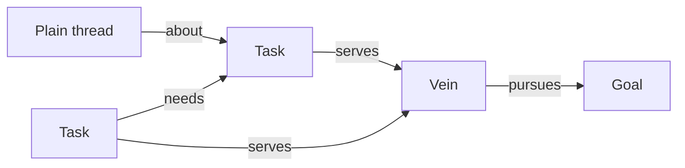

# Pardner thread model: threads, kinds, state and outcome

Status: **decided, with implementation tracked by #297.**

This file records decisions the owner made on 2026-11-23, after comparing Pardner
with Vercel Board ([assessment](PARDNER-VERCEL-BOARD-LESSONS.md)). [README](../README.md#current-implementation) and the
[acceptance contract](PARDNER-ACCEPTANCE.md) describe what Pardner does today.

A line marked **Proposed** is a detail put forward in that discussion that the
owner has not confirmed. Everything else is decided.

## Why

- **A conversation has no home before work exists.** A comment and a mention
  always belong to a task. A question to a colleague's agent, asked before anyone
  knows what the work is, has nowhere to go.
- **Veins and goals cannot hold discussion.** Their value is the verdict and the
  evidence behind it, and that evidence has no place to be written.
- **A status mixes two things.** `backlog`, `up-next`, `in-progress` and `review`
  say where work is. `completed`, `dead-end` and `abandoned` say how it ended.
- **Pardner stays work first.** Board makes the conversation primary and adds
  state to it. Pardner keeps the work primary and gives conversation a place at
  every level of it.

**What does not change**

- Every member machine holds a signed copy of the record.
- Edits to different fields merge. Competing edits to one field keep their authors
  until someone chooses.
- Work continues and saves while offline.
- A mention is acknowledged only after it is stored on disk.
- Only member machines can connect.
- A vein ends with a verdict and pursues one goal. A task can serve several veins.

## 1. One item: the thread

Everything in a project is a **thread**. A thread has a title, a description and
one flat list of comments. Threads never nest: a comment cannot start a thread or
have replies of its own.

A thread has a **kind**, which is one of four:

| Kind | What it is | Its vocabulary |
| --- | --- | --- |
| Plain thread | A question or a conversation | Unsettled or settled |
| Task | A piece of work | Open, then an outcome |
| Vein | One approach toward a goal | Open, then an outcome |
| Goal | The state being pursued | Open, then an outcome |

**Kind is fixed when the thread is created and never changes.**

- A plain thread is never converted. A task, a vein or a goal is *created from* it
  and linked back, and the conversation stays a conversation. One conversation can
  yield several pieces of work.
- There is no undo for a kind picked by mistake. Cancel the thread and create
  another from the same conversation.
- A task that grows into an approach is not converted either. Create the vein; the
  task serves it.

The reason is that a thread's kind gives meaning to what other people wrote about
it. A member machine cannot be refused a write and cannot see writes still held on
an offline machine, so a kind that changed would change the meaning of records
nobody is able to check.

A mention can point at a thread of any kind.

## 2. Tasks: responsibility and follow-up

The assignee is responsible for the task. A handoff changes that assignment,
records an explanation in the task discussion, and mentions the recipient.
A task shows **Open** until it has an outcome, then shows **Ended**. Concurrent
outcomes remain visible until someone resolves them.

An ordinary mention asks for someone's attention. An assigned to-do adds an
open item to the same task discussion when completion matters. Its assignee
can complete it under their own name and reply with their findings in the
thread. Open to-dos stay discoverable on ended tasks. They and their parent
have independent completion. Two distinct to-dos add two items even when
created offline. The same operation retried adds one item and one mention.

Genuine blockers concern work that cannot advance. How a blocker is recorded
and cleared is a separate product decision. Start controls, review holds and
claim leases are outside this milestone.

## 3. Outcomes

An outcome is a final judgment about a piece of work. One list serves tasks, veins
and goals:

| Outcome | Meaning | Replaces |
| --- | --- | --- |
| `completed` | Done | Task `completed`, vein `proven`, goal `achieved` |
| `dead-end` | It was tried and the answer is no | Task and vein `dead-end` |
| `abandoned` | We chose to stop | `abandoned` on all three |

No outcome means the thread is open. Clearing an outcome reopens it. A vein's
outcome is its verdict.

A worker who stops can explain what happened in a comment and hand off the
work if someone else needs to take over. `dead-end` and `abandoned` are
judgments about the work itself. Veins and goals carry their own outcomes.
A vein prompts for a verdict when every linked task's current alternatives
have outcomes.

## 4. Plain threads: settled

A plain thread is **unsettled** or **settled**. Settling is cheap and can be undone.
The list of unsettled threads shows where attention is needed, including for people
who were not mentioned.

Follow-up for a task lives in its discussion. Assign a to-do when someone owes an answer.

**Proposed.** A new comment un-settles a thread. The settle marker records the last
comment it covers, so a thread with anything newer reads as unsettled, and a comment
written on an offline machine brings the thread back when it syncs.

## 5. Fields, relations and labels

Three words describe what is recorded on a thread. They share one mechanism
underneath: one signed, mergeable record per value.

| | Examples | What is checked on read |
| --- | --- | --- |
| **Field** | Assignee, outcome | The value is one the field allows |
| **Relation** (`rel`) | Serves, pursues, needs, about | The target exists and is the right kind |
| **Label** | `area=sync`, `risk=high` | Nothing |

Reading is uniform: one filter and one `wait` work across all three. Writing is
not: each field and relation is written by the command that knows its rules, and
only labels are written freely. "Link" keeps its meaning of a pointer outside the
project, such as a GitHub issue or a commit.

**Relations are named by their verb and direction.**

| Relation | From | To | Notes |
| --- | --- | --- | --- |
| serves | Task | Vein | Many. One record per relation, keyed by both threads. The vein owns it |
| pursues | Vein | Goal | One. Competing moves are kept until someone chooses, as today |
| needs | Task | Task | Many. See section 6 |
| about | Plain thread | Any thread | Changes no state |

The vein owns its relations to tasks: adding or removing a task is a change to the
vein, it appears in the vein's history, and it is the vein's subscribers who are
woken. Creating a task in a vein remains one operation.

Because kind is fixed and `serves` and `pursues` each point one way, those two
relations cannot form a cycle.

Labels replace task tags and gain a key.

## 6. Prerequisites

A task can need another task.

**Proposed rules.**

1. Only a task can need another task.
2. Only `completed` satisfies a prerequisite. If machines recorded competing
   outcomes, it counts only when every one of them is `completed`.
3. A task whose prerequisite ended as `dead-end` or `abandoned` says so, and does
   not read as plainly waiting.
4. Creating a cycle is refused on the machine that tries it. A cycle that forms by
   merging is flagged, and each task in it reads as waiting on a cycle.

## 7. Waking an agent

Decided order of work:

1. `wait`, a command that blocks until a mention, a reply or a matching change, and
   is answered by the local replica (#285).
2. A reminder: a comment that mentions an Actor at a set time (#291).
3. A worker command that runs any agent or script on the next ready task, after
   #282.
4. A one-way notice to a person (#293), and GitHub state arriving as labels (#296),
   each after a design of its own.

## 8. Decided against, or deferred

- **Channels** are deferred. Nothing above needs them, and one could be added later
  as a label on a thread.
- **A changeable kind, a time limit on changing it, and an undo command** are
  decided against. See section 1.
- **A stored status** and **`failed` as an outcome** are decided against. See
  sections 2 and 3.

## 9. Beside Board's statuses

| Board | Pardner |
| --- | --- |
| `ready` | Open |
| `completed` | `completed` |
| `failed` | A comment explaining what happened |
| `canceled` | `abandoned` |
| (none) | `dead-end` |

Board stores one status and is the only writer of it. Pardner derives Open or Ended from the outcome.

## 10. Open questions

- **Claims on work, and whether a worker's run is its own record:** #282. Execution tracking remains a separate design question.
- **What stays in the Automerge board:** #283.
- **What task branches are for** under this model: #292.
- **Who may record which outcome** before permissions by kind exist: followed in
  #292, since proposing by branch is the likely answer.
- **How label keys that drift apart are flagged:** followed in #294.
